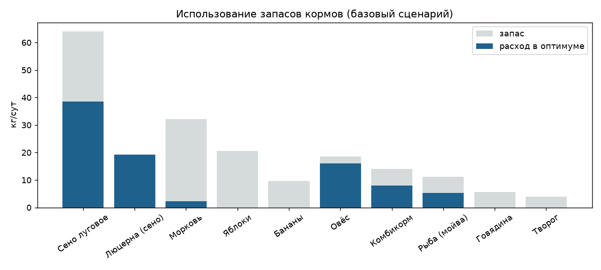
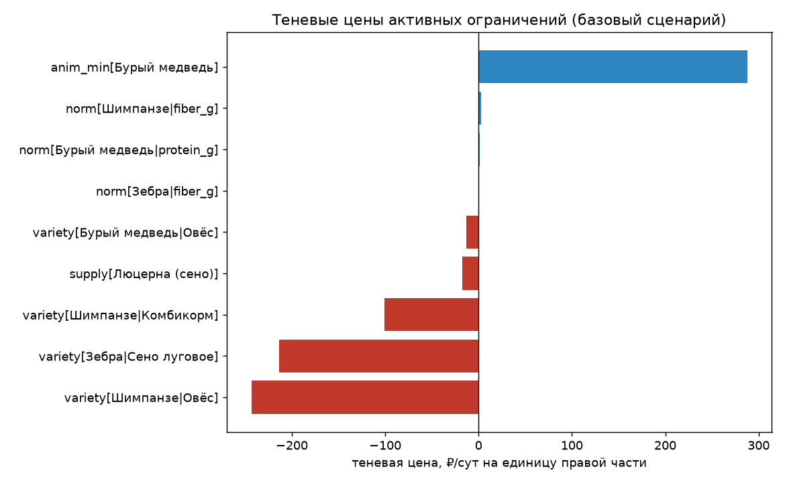
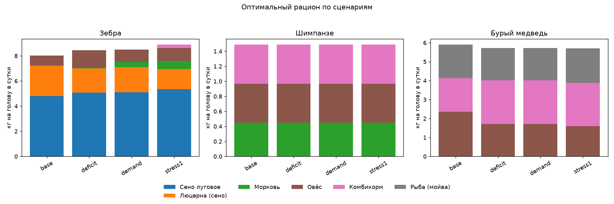
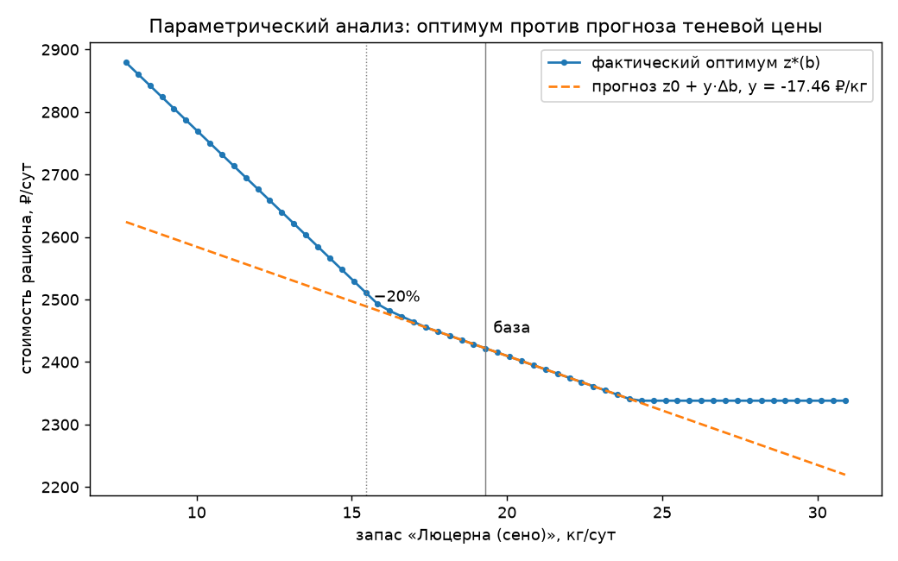

# Отчёт по лабораторной работе №1 «ЛП-модель распределения ресурсов»

**Вариант 16.** Рацион кормления в зоопарке с требованием разнообразия: 10 кормов, 5 норм, 3 вида животных.
Группа 527 (Q = 2), номер в группе N = 15, Y = 26:
V = 1 + ((17·15 + 7·2 + 26) mod 20) = 1 + (295 mod 20) = **16**, seed = 10000 + 100·2 + 15 = **10215**.

Солвер: HiGHS 1.15.1 (`highspy`), Python 3.14.7. Запуск: `python run.py`.

## 1. Постановка задачи

Кухня зоопарка ежедневно готовит корм для трёх видов: зебры (8 голов), шимпанзе (5) и бурые медведи (3).
На складе есть 10 кормов с известной ценой, суточным запасом и питательностью. Нужно составить суточный рацион
для каждого вида, чтобы:

- выполнялись ветеринарные нормы по энергии, протеину, жиру, клетчатке и кальцию;
- рацион помещался в желудок (ограничение по массе);
- рацион был разнообразным: ни один корм не превышает заданной доли массы рациона;
- доля кормов животного происхождения была в допустимых для вида пределах (зебра — травоядное, медведь — всеядный хищник);
- не превышались суточные запасы склада;
- суммарная стоимость кормления была минимальной.

## 2. Формальная модель

**Множества.** F — корма (10), A — виды животных (3), K — нутриенты (5: энергия, протеин, жир, клетчатка, кальций),
F_anim ⊂ F — корма животного происхождения (рыба, говядина, творог).

**Параметры.**

| Обозначение | Смысл | Единицы |
|---|---|---|
| c_f | цена корма | ₽/кг |
| S_f | суточный запас корма на складе | кг/сут |
| a_fk | содержание нутриента k в 1 кг корма f | МДж/кг или г/кг |
| n_a | поголовье вида | голов |
| L_ak, U_ak | нижняя/верхняя норма нутриента на 1 голову | МДж/сут или г/сут |
| M_a | максимальная масса рациона | кг/гол/сут |
| s_a | максимальная доля одного корма в рационе | — |
| p_a^min, p_a^max | пределы доли кормов животного происхождения | — |
| e_af ∈ {0,1} | корм допустим для вида (ветеринарная совместимость) | — |

**Переменные.** x_af ≥ 0 — масса корма f в суточном рационе одной головы вида a, кг/гол/сут (непрерывные, 30 штук).

**Целевая функция** — стоимость кормления всего зоопарка, ₽/сут:

  min z = Σ_a Σ_f n_a · c_f · x_af

**Ограничения** (все приведены к виду Ax ≤ b; двусторонние нормы — две строки):

1. Нормы нутриентов, для всех a, k: L_ak ≤ Σ_f a_fk · x_af ≤ U_ak (граница отсутствует, где норма не задана).
2. Объём рациона: Σ_f x_af ≤ M_a.
3. Разнообразие: x_af − s_a · Σ_g x_ag ≤ 0 для каждого допустимого корма. Если s_a = 0,35, в рационе не менее ⌈1/0,35⌉ = 3 кормов — так «требование разнообразия» выражается линейно, без бинарных переменных.
4. Доля кормов животного происхождения: p_a^min · Σ_f x_af ≤ Σ_{f∈F_anim} x_af ≤ p_a^max · Σ_f x_af.
5. Запасы склада: Σ_a n_a · x_af ≤ S_f.
6. Совместимость: x_af = 0 при e_af = 0 (задано верхней границей переменной), x_af ≥ 0.

Размер модели: 30 переменных, 52 строки, 441 ненулевой коэффициент.

### Данные (`data/`, seed 10215)

Опорные значения питательности и цен взяты по порядку величин из справочных таблиц и возмущены: цены и запасы — ×U(0,9; 1,1), питательность и нормы — ×U(0,95; 1,05).

| Корм | ₽/кг | Запас, кг/сут | МДж/кг | Протеин, г/кг | Жир, г/кг | Клетчатка, г/кг | Ca, г/кг |
|---|---|---|---|---|---|---|---|
| Сено луговое | 11,42 | 64,12 | 7,65 | 85,9 | 19,5 | 272,5 | 6,01 |
| Люцерна (сено) | 19,66 | 19,31 | 8,37 | 174,8 | 24,3 | 260,1 | 14,16 |
| Морковь | 37,96 | 32,24 | 1,68 | 9,6 | 2,0 | 27,6 | 0,34 |
| Яблоки | 60,47 | 20,55 | 2,26 | 2,9 | 1,9 | 20,8 | 0,06 |
| Бананы | 107,77 | 9,59 | 3,60 | 10,5 | 2,9 | 26,1 | 0,05 |
| Овёс | 23,81 | 18,61 | 11,10 | 112,3 | 42,8 | 96,0 | 0,95 |
| Комбикорм | 48,83 | 14,09 | 11,53 | 154,2 | 38,8 | 89,2 | 9,10 |
| Рыба (мойва) | 140,73 | 11,25 | 5,79 | 146,1 | 83,2 | 0 | 3,98 |
| Говядина | 409,47 | 5,60 | 7,99 | 199,3 | 120,9 | 0 | 0,10 |
| Творог | 241,83 | 4,00 | 5,26 | 172,0 | 48,7 | 0 | 1,58 |

| Вид | Голов | M_a, кг | s_a | Доля живот. кормов | Запрещено |
|---|---|---|---|---|---|
| Зебра | 8 | 12 | 0,60 | 0 | рыба, говядина, творог, бананы |
| Шимпанзе | 5 | 5 | 0,35 | ≤ 0,15 | сено, люцерна, говядина |
| Бурый медведь | 3 | 15 | 0,40 | 0,30…0,70 | сено, люцерна |

Нормы на голову (`data/norms.csv`) — например, у зебры клетчатка ≥ 2015,6 г, у медведя протеин ≥ 797,7 г.

### Допущения и учебные упрощения

- Питательность аддитивна: нутриенты рациона — линейная сумма вкладов кормов (нет взаимодействий и потерь при усвоении).
- Цены постоянны и не зависят от объёма закупки (нет оптовых скидок).
- Поголовье и рацион одинаковы для всех особей вида (нет поправки на вес, возраст, беременность).
- Массы непрерывны: 0,447 кг моркови допустимы, хотя на практике порции округляются.
- Нормы по массе указаны «как скормлено» (as-fed), без пересчёта на сухое вещество.
- Вкусовые предпочтения, поедаемость и «минимальная сытость» не моделируются (см. раздел 9).

При первой генерации данных базовая задача оказалась **несовместной**: эластичная модель показала, что норма клетчатки
у шимпанзе (≈ 149 г) недостижима при запрете сена и потолке энергии 14 МДж — не хватало ≈ 20 г. Норму снизили до
опорных 110 г (с шумом — 108,96 г), что ближе к реальным нормам для фруктово-овощного рациона.

## 3. Реализация

- `zoo_lp/model.py`: модель собирается как матрица `A` с двусторонними границами строк (формат HiGHS `row_lo ≤ Ax ≤ row_hi`) и передаётся в `highspy.Highs.passModel` в CSC-формате.
- Алгоритм: **двойственный симплекс** (`solver="simplex"`) — он даёт базисное (вершинное) решение, теневые цены и анализ чувствительности (`getRanging`). Метод внутренней точки сравнивается в разделе 9.
- Presolve включён: он удаляет 9 зафиксированных в 0 переменных (запрещённые корма) и 4 строки → 48 × 21. После решения выполняется postsolve, теневые цены возвращаются для исходной модели.
- Лог солвера: `results/highs_<сценарий>.log`.
- Несовместность диагностируется двумя способами: **deletion filter** (поиск неприводимой несовместной подсистемы, IIS) и **эластичная модель** (минимальное относительное ослабление ограничений выбранных групп).

## 4. Базовое решение

**Статус: `Optimal`** — HiGHS доказал оптимальность: найдено допустимое решение и допустимое двойственное решение с одинаковым значением цели (P-D objective error = 0). Значит, дешевле накормить животных при этих нормах нельзя. 11 итераций двойственного симплекса.

**Минимальная стоимость кормления: 2421,86 ₽/сут.**

| Вид | Рацион на 1 голову, кг/сут | Масса, кг | ₽/сут на вид | ₽/гол/сут |
|---|---|---|---|---|
| Зебра (8) | сено 4,813; люцерна 2,414; овёс 0,795 | 8,02 | 970,71 | 121,34 |
| Шимпанзе (5) | морковь 0,447; овёс 0,522; комбикорм 0,522 | 1,49 | 274,36 | 54,87 |
| Бурый медведь (3) | овёс 2,363; комбикорм 1,772; рыба 1,772 | 5,91 | 1176,80 | 392,27 |

Что получилось содержательно:

- **Зебры** едят дешёвое сено ровно на пределе разнообразия (60% массы), недостающие протеин и клетчатку дают люцерна и овёс. Вся люцерна склада (19,31 кг) уходит зебрам — это единственный исчерпанный запас.
- **Шимпанзе** получают минимальный по разнообразию набор из трёх кормов (овёс и комбикорм ровно по 35%), выходят на минимум клетчатки 108,96 г. Фрукты не покупаются — они дороги относительно питательности.
- **Медведи** — овёс, комбикорм и рыба; доля рыбы ровно 30% (нижний предел кормов животного происхождения), протеин ровно на норме 797,7 г. Говядина и творог не нужны — рыба даёт протеин дешевле.

Нутриенты рациона (`results/ration_nutrients_base.csv`): у зебры энергия 65,8 МДж (норма 47,9…71,8), протеин 924,6 г (≥ 509,7), клетчатка 2015,6 г — **на границе**; у медведя протеин 797,7 г — **на границе**.

## 5. Независимая проверка

`zoo_lp/verify.py` получает только исходные CSV и таблицу решения (кг/гол/сут). Матрица модели и объект солвера не используются: каждое ограничение пересчитывается по своей предметной формулировке на NumPy с допуском 1e-7 (относительно max(1, |rhs|)).

- Проверено **95 условий**: неотрицательность (30), запрещённые корма (9), нормы min/max (18), объём рациона (3), разнообразие (21), доля кормов животного происхождения (3), запасы (10) и пересчёт цели.
- **Все выполнены**, максимальное нарушение 1,8·10⁻¹⁵ (машинная точность).
- Целевая функция, пересчитанная как Σ n_a · c_f · x_af, = 2421,8627 ₽/сут, совпадает с солвером.
- Так же проверены все допустимые сценарии (`check_all_ok = True` в `results/scenarios.csv`).

Полная таблица: `results/check_base.csv`.

## 6. Теневые цены активных ограничений

В HiGHS двойственная переменная строки y_i = ∂z*/∂b_i — на сколько ₽/сут изменится оптимальная стоимость при сдвиге границы на единицу. Диапазон — интервал правой части, в котором базис (а значит, и теневая цена) не меняется (`getRanging`).

| Ограничение | Теневая цена | Диапазон устойчивости правой части | Эффект ослабления на 1%, ₽/сут |
|---|---|---|---|
| Запас люцерны (19,31 кг) | −17,46 ₽ за кг | [17,38; 24,11] кг | 3,37 |
| Норма клетчатки зебры (2015,6 г) | +0,649 ₽ за г | [1614,5; 2148,8] г | 13,08 |
| Норма протеина медведя (797,7 г) | +1,475 ₽ за г | [570,7; 998,7] г | 11,77 |
| Норма клетчатки шимпанзе (109,0 г) | +2,518 ₽ за г | [89,1; 118,3] г | 2,74 |
| Мин. доля живот. кормов медведя (30%) | +287,7 ₽ за кг | — | 17,00 (на 1 п.п.) |
| Разнообразие: сено у зебры (60%) | −213,7 ₽ за кг | — | 17,14 (на 1 п.п.) |
| Разнообразие: овёс у шимпанзе (35%) | −243,0 ₽ за кг | — | 3,62 (на 1 п.п.) |
| Разнообразие: комбикорм у шимпанзе | −100,9 ₽ за кг | — | 1,50 (на 1 п.п.) |
| Разнообразие: овёс у медведя (40%) | −13,2 ₽ за кг | — | 0,78 (на 1 п.п.) |

**Что выгодно нарастить в первую очередь.** Из ресурсов, которыми управляет зоопарк, исчерпан только запас **люцерны**: каждый дополнительный килограмм экономит 17,46 ₽/сут. Цена 19,66 ₽/кг уже учтена в цели, поэтому докупать люцерну выгодно по цене до 19,66 + 17,46 ≈ **37,1 ₽/кг**. Эффект действует только до 24,11 кг/сут (+4,8 кг): дальше люцерна перестаёт быть дефицитом и теневая цена падает до 0 (плато на графике параметрического анализа). Запасы остальных кормов не исчерпаны (теневая цена 0), докупать их бессмысленно.

Самые «дорогие» по эффекту на 1% ограничения — правила содержания: доля сена у зебры (17,1 ₽/сут на 1 п.п.), минимальная доля рыбы у медведя (17,0) и нормы клетчатки зебры (13,1) и протеина медведя (11,8). Их смягчение — решение ветеринара, а не закупка, но оценка показывает, какие правила содержания стоят дороже всего.

## 7. Сценарный анализ

Поголовье входит и в цель, и в ограничения по запасам, поэтому z(k·n, S) = k · z(n, S/k). Отсюда прогноз по теневым ценам базового решения: z ≈ k · (z₀ + Σ_f y_f · (s_f·S_f/k − S_f)), где s_f — множитель запаса, k — множитель поголовья.

| Сценарий | Статус | z*, ₽/сут | Δ к базе | Прогноз по теневым ценам | Ошибка прогноза | Исчерпанные запасы (теневая цена, ₽/кг) |
|---|---|---|---|---|---|---|
| Базовый | Optimal | 2421,86 | — | 2421,86 | 0 | люцерна (−17,46) |
| Дефицит: люцерна −20% | Optimal | 2511,20 | +89,34 (+3,7%) | 2489,28 | +21,92 | люцерна (−47,65), овёс (−22,79) |
| Рост спроса: поголовье +20% | Optimal | 3061,44 | +639,58 (+26,4%) | 2973,66 | +87,79 | люцерна (−47,65), овёс (−22,79) |
| Стресс-1: сено и люцерна −20%, поголовье +20% | Optimal | 3285,54 | +863,68 (+35,7%) | 3041,08 | +244,47 | сено (−278,6), люцерна (−270,3), овёс (−88,3), комбикорм (−56,0) |
| Стресс-2 (засуха): сено и люцерна −40%, поголовье +20% | **Infeasible** | — | — | 3108,50 (неверен) | — | — |

**Дефицит (люцерна −20%, 19,31 → 15,45 кг/сут).** Ключевой ресурс выбран автоматически — ограничение запаса с наибольшей |теневой ценой|. Зебрам не хватает люцерны (2,41 → 1,93 кг/гол): протеин и клетчатку замещают сено (до 5,07 кг) и овёс (0,80 → 1,36 кг). Овса на складе теперь не хватает, поэтому медведям дают меньше овса (2,36 → 1,72) и больше комбикорма (1,77 → 2,29). Стоимость выросла на 89,34 ₽/сут. Рацион шимпанзе не изменился.

**Рост спроса (+20% поголовья).** Стоимость выросла на 26,4% — больше, чем на пропорциональные 20%: люцерны и овса на возросшее стадо не хватает, приходится переходить на более дорогие комбинации (у зебры появляется морковь). Затраты на одну зебру 121,34 → 136,56 ₽/сут.

**Стресс-1 (двойное ухудшение: −20% сена и люцерны и +20% поголовья).** Решение существует, но система на грани: исчерпаны четыре запаса, теневая цена люцерны выросла в 15 раз (17,46 → 270,3 ₽/кг), сено тоже стало дефицитным (278,6 ₽/кг) — каждый недостающий килограмм грубого корма стоит дорого. Зебрам добавляется комбикорм.

**Стресс-2 (засуха: −40% сена и люцерны и +20% поголовья) — статус `Infeasible`.** HiGHS доказал (на этапе presolve), что ни одного рациона, удовлетворяющего всем ограничениям, не существует. Увеличение времени или смена алгоритма не помогут — нужно менять условия.

- **Конфликтующие ограничения (IIS, deletion filter, `results/iis_stress2.csv`):** норма клетчатки зебры и запасы всех шести допустимых для зебры кормов (сено, люцерна, морковь, яблоки, овёс, комбикорм). Смысл: даже если отдать зебрам все растительные корма склада, в них 17 858 г клетчатки, а 9,6 зебрам нужно 9,6 × 2015,6 = 19 350 г. Ни разнообразие, ни объём желудка, ни нужды других видов для конфликта не обязательны.
- **Эластичная модель (`results/elastic_stress2.csv`):** минимальное ослабление — снизить норму клетчатки зебры на 297 г/гол (−14,7%) либо, если нормы неприкосновенны, **докупить 13,8 кг сена в сутки** (запас 38,5 → 52,2 кг) — этого достаточно для восстановления допустимости.

### Совпадает ли прогноз теневой цены с фактом?

Внутри диапазона устойчивости — да, точно. Вне его — нет. Параметрический анализ по запасу люцерны (`results/parametric_key_supply.csv`):

| Запас люцерны, кг | Факт z*, ₽/сут | Прогноз z₀ + y·Δb | Ошибка |
|---|---|---|---|
| 25,10 (+30%) | 2338,10 | 2320,73 | +17,37 |
| 23,94 (+24%) | 2340,96 | 2340,96 | 0,00 |
| 21,24 (+10%) | 2388,15 | 2388,15 | 0,00 |
| 18,54 (−4%) | 2435,35 | 2435,35 | 0,00 |
| 17,38 (−10%) | 2455,59 | 2455,57 | 0,02 |
| 15,45 (−20%) | 2511,20 | 2489,28 | +21,92 |
| 11,59 (−40%) | 2695,22 | 2556,70 | +138,52 |

z*(b) для задачи на минимум — выпуклая кусочно-линейная функция правой части. Теневая цена — наклон текущего линейного участка, поэтому прогноз точен на [17,38; 24,11] кг (этот же диапазон даёт `getRanging`) и **занижает** рост стоимости за его пределами: при −20% запас 15,45 кг выходит за нижнюю границу 17,38, базис меняется, в дефиците оказывается ещё и овёс, наклон растёт до −47,65 ₽/кг. При увеличении запаса сверх 24,11 кг люцерна перестаёт быть дефицитной и наклон становится 0 — прогноз завышает экономию. Для сценариев с ростом поголовья прогноз тоже занижает ущерб (3061 против 2974) по той же причине: эквивалентное снижение запаса люцерны в 1,2 раза (до 16,1 кг) выходит за диапазон.

## 8. Нулевые переменные

Из 30 переменных положительны только 9. Причины две.

1. **9 переменных запрещены** ветеринарной совместимостью (сено у шимпанзе, мясо у зебры и т.п.) — их нулевое значение задано данными.
2. **12 допустимых переменных равны 0 по экономике.** Оптимум ЛП достигается в вершине многогранника, где число положительных базисных переменных не больше числа активных ограничений. Корм входит в рацион, только если его приведённая стоимость (reduced cost) неположительна — то есть он даёт нутриенты дешевле, чем текущая «цена» нутриентов, заданная теневыми ценами норм. У всех нулевых кормов приведённая стоимость строго положительна (`results/cost_ranging.csv`):

| Корм / вид | Приведённая стоимость (₽/сут на 1 кг/гол) | На сколько должна упасть цена, чтобы корм вошёл в рацион |
|---|---|---|
| Яблоки / шимпанзе | 129,6 | 25,9 ₽/кг (60,47 → 34,6) |
| Бананы / шимпанзе | 352,9 | 70,6 ₽/кг (107,77 → 37,2) |
| Морковь / зебра | 157,6 | 19,7 ₽/кг (37,96 → 18,3) |
| Говядина / медведь | 727,8 | 242,6 ₽/кг (409,47 → 166,9) |
| Творог / медведь | 265,2 | 88,4 ₽/кг (241,83 → 153,4) |

(коэффициент цели = n_a · c_f, поэтому пороги в ₽/кг получены делением на поголовье.)

Предметный смысл есть: модель отбрасывает корма, которые дороже дают те же нутриенты (говядина против рыбы, фрукты против овса и комбикорма). Но **с точки зрения зоотехника это частично недостаток модели**: шимпанзе без фруктов и медведь без ягод и фруктов — неполноценный по поведению и вкусу рацион. Модель не знает о витаминах, поедаемости и психологии животных, поэтому в ней нужны явные минимумы (например, фрукты ≥ 30% рациона шимпанзе).

Признаков альтернативных оптимумов нет: у всех нулевых допустимых переменных приведённая стоимость строго положительна, а у всех активных ограничений теневая цена ненулевая. Признаков вырожденности тоже нет: диапазоны устойчивости правых частей содержат текущее значение строго внутри.

## 9. Дополнительные задания

**Анализ диапазонов устойчивости коэффициентов цели** (`results/cost_ranging.csv`). Для базисных переменных — интервал коэффициента, в котором базис остаётся оптимальным. Например, сено у зебры: [−127; 540,9] ₽/сут на кг/гол → цена сена может вырасти с 11,42 до 540,9/8 ≈ 67,6 ₽/кг, а рацион зебры по составу не изменится. Рыба у медведя: [139,6; 563,4] → 46,5…187,8 ₽/кг. Комбикорм у медведя: нижняя граница 132,0 → при цене ниже 44,0 ₽/кг (сейчас 48,83) базис сменится.

**Сравнение симплекс-метода и метода внутренней точки** (`results/solver_comparison.csv`, медиана 30 запусков):

| Алгоритм | Presolve | Итерации | Время, мс | z* |
|---|---|---|---|---|
| Двойственный симплекс | on | 11 | 0,54 | 2421,8627 |
| Двойственный симплекс | off | 13 | 0,18 | 2421,8627 |
| Внутренняя точка (IPM) | on | 8 | 1,49 | 2421,8627 |
| Внутренняя точка (IPM) | off | 9 | 1,16 | 2421,8627 |

Все варианты дают одинаковую цель. На задаче 52 × 30 симплекс быстрее: итерация IPM (факторизация матрицы) дороже нескольких пивотов, а presolve на таком масштабе занимает больше времени, чем экономит. Для анализа чувствительности симплекс предпочтительнее — он даёт базис, нужный для `getRanging`.

## 10. Выводы

1. Минимальная стоимость кормления 3 видов (16 голов) — **2421,86 ₽/сут**, из них ≈ 49% приходится на медведей. Решение оптимально (статус `Optimal`) и независимо проверено по 95 условиям.
2. Единственный дефицитный ресурс склада — **люцерна**. Её стоит докупать по цене до ≈ 37 ₽/кг в объёме до +4,8 кг/сут — это даёт до 84 ₽/сут экономии.
3. Система устойчива к умеренным потрясениям (−20% люцерны: +3,7% затрат; +20% поголовья: +26,4%), но двойной удар по грубым кормам на фоне роста стада делает задачу несовместной: зебрам физически не хватает клетчатки. Страховой запас — ≈ 14 кг сена в сутки сверх засушливого уровня.
4. Теневые цены точно прогнозируют изменение стоимости только в своём диапазоне устойчивости. При −20% люцерны прогноз занижает рост затрат на 22 ₽ (25%), потому что меняется базис.

### Можно ли реализовать решение на практике?

Частично: как **ориентир для закупок и нижняя граница затрат**, но не как готовое меню. Мешают:

- **нет минимальной сытости и поедаемости:** у шимпанзе получилось 1,49 кг корма в сутки вместо реальных 3–5 кг, у медведя 5,9 кг — модель удовлетворяет нормы самыми концентрированными кормами;
- **не учтены витамины, микроэлементы и поведенческие потребности:** фрукты у шимпанзе нулевые;
- **непрерывность:** порции нужно округлять (0,447 кг моркови), а корма поставляются партиями;
- **однородность особей:** нормы зависят от массы, возраста и состояния животного;
- **детерминированность:** цены и запасы на самом деле колеблются, а стресс-сценарии показывают, что на грани возможностей решение резко дорожает или исчезает.

Для практического применения модель нужно дополнить минимальной массой рациона, минимальными долями фруктов и овощей, а для дискретных партий закупки — целочисленными переменными (MILP).
