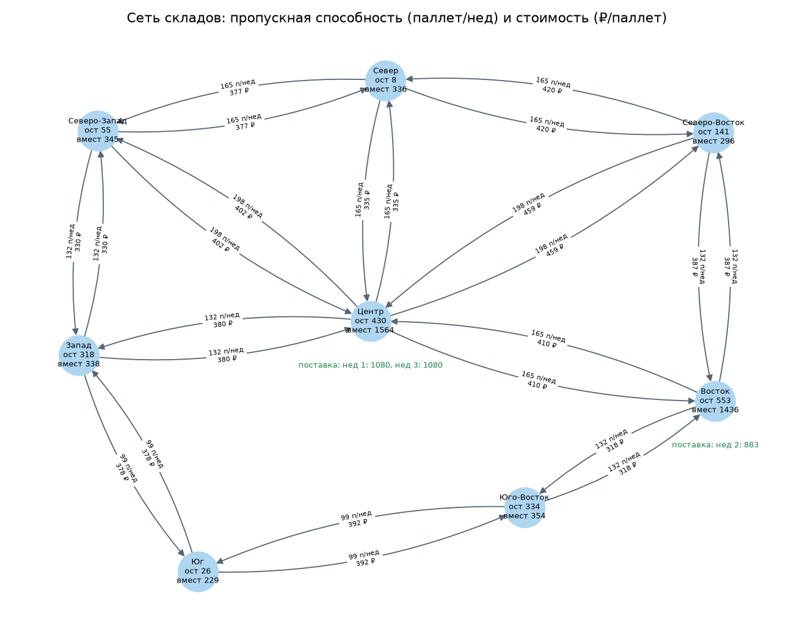
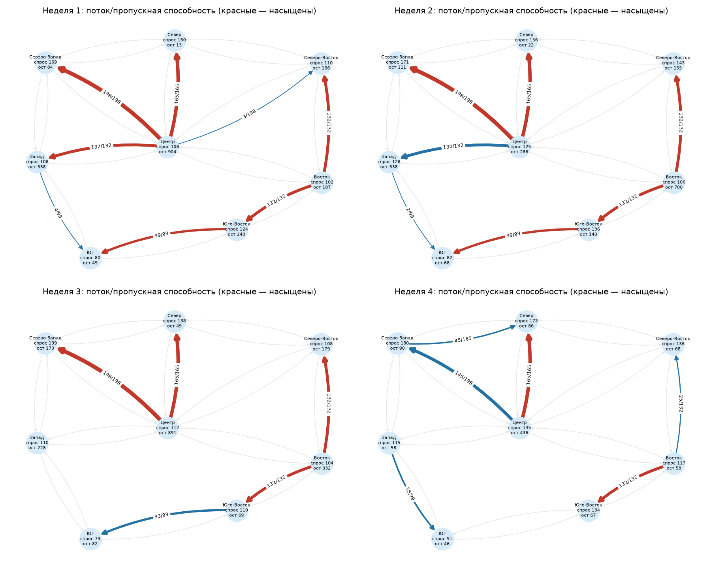
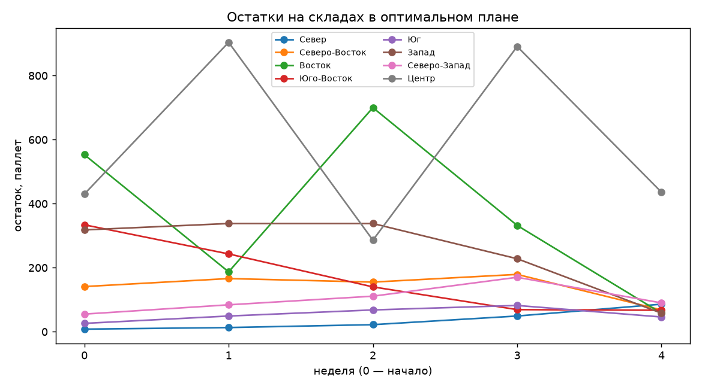
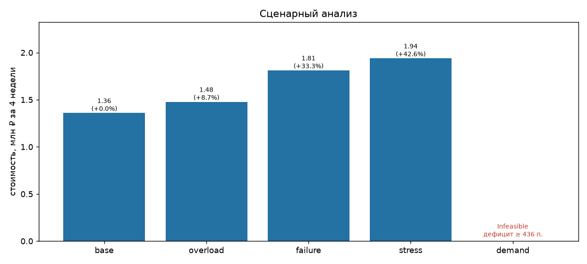
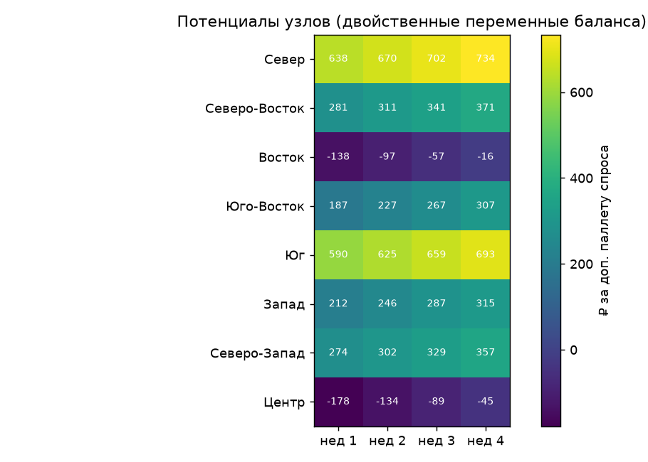
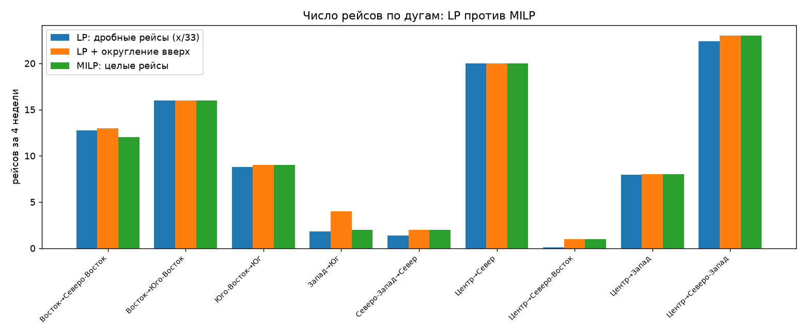

# Отчёт по лабораторной работе №2 «Транспортные и сетевые модели»

**Вариант 16.** Балансировка запасов между складами розничной сети: 8 складов, горизонт 4 недели.
Группа 527 (Q = 2), N = 15, Y = 26 → V = 1 + (295 mod 20) = **16**, seed = **10215**.
Солвер: HiGHS 1.15.1 (`highspy`), Python 3.14.7, NetworkX 3.7 (только визуализация и эвристика). Запуск: `python run.py`.

## 1. Постановка задачи

Розничная сеть владеет 8 складами. Начальные остатки распределены неравномерно: на Востоке 553 паллеты, на Севере — 8.
Производитель привозит товар только на два склада: в Центр (по 1080 паллет на 1-й и 3-й неделе) и на Восток
(883 паллеты на 2-й неделе). Каждый склад должен закрывать свой еженедельный спрос, не переполняться и к концу
4-й недели сохранить страховой остаток. Товар можно перебрасывать между складами по 12 дорогам (в обе стороны).
Число рейсов фур по каждой дороге ограничено. Нужно найти план перевозок и хранения минимальной стоимости.

## 2. Описание сети

- **Вершины:** 8 складов. Центр соединён спицами с пятью складами (дорог Центр—Юго-Восток и Центр—Юг нет), а внешние склады — кольцом. В модели вершина — пара (склад, неделя): 8 × 4 = 32 узла.
- **Дуги:** 24 направленные дороги × 4 недели = 96 дуг перевозки. Ещё 32 дуги хранения отвечают за перенос остатка: 24 дуги (w, t) → (w, t+1) и 8 дуг из последней недели в конец горизонта (на них действует страховой остаток).
- **Пропускная способность:** число рейсов в неделю (3–6) × 33 паллеты в фуре = 99…198 паллет/нед.
- **Стоимость перевозки:** погрузка-выгрузка (50–80 ₽/паллет) + рейс фуры (2500 + 45 ₽/км) / 33 = 318…459 ₽/паллет.
- **Хранение:** 25–45 ₽ за паллету в неделю. Вместимость склада — 229…1564 паллеты.
- **Предложение и спрос:** суммарное предложение (остатки + поставки) — 4908 паллет. Суммарный спрос — 3999 паллет плюс 545 паллет страхового остатка. Запас прочности сети по объёму — 8%.

| Дорога | км | ₽/паллет | паллет/нед |
|---|---|---|---|
| Север — Северо-Восток | 212,0 | 419,85 | 165 |
| Северо-Восток — Восток | 171,7 | 387,00 | 132 |
| Восток — Юго-Восток | 134,2 | 317,79 | 132 |
| Юго-Восток — Юг | 194,2 | 391,61 | 99 |
| Юг — Запад | 163,7 | 378,09 | 99 |
| Запад — Северо-Запад | 146,3 | 330,15 | 132 |
| Северо-Запад — Север | 184,3 | 376,97 | 165 |
| Центр — Север | 152,4 | 334,64 | 165 |
| Центр — Северо-Восток | 232,8 | 459,33 | 198 |
| Центр — Восток | 204,1 | 409,94 | 165 |
| Центр — Запад | 182,1 | 380,24 | 132 |
| Центр — Северо-Запад | 199,6 | 401,88 | 198 |

Данные лежат в `data/*.csv`. Процедура генерации описана в `netflow/data_gen.py`: координаты складов на окружности
со случайным радиусом, длина дорог с коэффициентом извилистости 1,15–1,35, спрос = базовый уровень × сезонность
недели (1,00; 1,10; 0,95; 1,15) × шум ±10%, начальные остатки распределены по закону Дирихле.

## 3. ЛП-постановка (поток минимальной стоимости в развёрнутой по времени сети)

**Множества:** W — склады, T = {1..4} — недели, R ⊂ W × W — направленные дороги.

**Параметры:** c_ij — стоимость перевозки, ₽/паллет; u_ij — пропускная способность, паллет/нед; h_w — хранение, ₽/паллет/нед;
d_wt — спрос, паллет/нед; p_wt — поставка производителя, паллет/нед; I_w0 — начальный остаток; K_w — вместимость склада;
ss_w — страховой остаток на конец горизонта, паллет.

**Переменные (непрерывные):** x_ijt ≥ 0 — паллет по дороге (i, j) за неделю t (96 шт.); I_wt ≥ 0 — остаток склада w в конце недели t (32 шт.).

**Цель:** min Σ_t Σ_(i,j) c_ij x_ijt + Σ_t Σ_w h_w I_wt, ₽ за 4 недели.

**Ограничения:**

1. Баланс в каждой вершине (w, t): I_w,t−1 + p_wt + Σ_i x_iwt − Σ_j x_wjt − I_wt = d_wt (32 равенства).
2. Пропускная способность: 0 ≤ x_ijt ≤ u_ij.
3. Вместимость: 0 ≤ I_wt ≤ K_w.
4. Страховой остаток: I_w4 ≥ ss_w.

Ограничения 2–4 — это границы переменных, поэтому в матрице только 32 строки баланса (128 переменных, 248 ненулевых коэффициентов).
Матрица — узел-дуговая матрица инцидентности: каждая перевозка входит в баланс отправителя с −1, получателя с +1.

**Допущения:**

- Перевозка занимает меньше недели: отправленное на неделе t приходит на той же неделе.
- Стоимость рейса делится на 33 паллеты — это линейная аппроксимация. Она точна, только если фура полная; неполную загрузку учитывает дополнительное задание (MILP).
- Спрос и поставки известны заранее (детерминированная модель).
- Нехватка товара в основной модели запрещена. Если без неё не обойтись, задача несовместна, и тогда дефицит диагностируется отдельной моделью (раздел 6).

## 4. Решение и интерпретация статуса

**Статус `Optimal`:** HiGHS (двойственный симплекс, 50 итераций, presolve убрал 1 строку и 1 столбец) нашёл допустимый план и доказал, что дешевле нельзя.

**Минимальная стоимость — 1 359 053,96 ₽ за 4 недели:** перевозки 1 103 558 ₽ (81%), хранение 255 496 ₽ (19%). Перевезено 3010 паллет.

**Решение целочисленно без требования целочисленности.** Матрица инцидентности сети тотально унимодулярна, а все данные — целые, поэтому любая вершина допустимого многогранника целочисленна. Симплекс-метод возвращает вершину, значит, перевозки получаются в целых паллетах.

Что происходит содержательно:

- **Центр** — главный распределительный узел. Каждую неделю он отправляет 165 паллет на Север и 198 на Северо-Запад (на 4-й неделе — 145), а на неделях 1–2 ещё 132 и 130 паллет на Запад — Запад делает запас и дальше обходится без завоза.
- **Восток** раздаёт свою поставку соседям по кольцу: Юго-Востоку по 132 паллеты каждую неделю, Северо-Востоку по 132 на неделях 1–3 и 25 на 4-й.
- **Юг** не связан с Центром, поэтому на неделях 1–3 его снабжают по цепочке Восток → Юго-Восток → Юг (99, 99, 93 паллеты), а на 4-й неделе — с Запада (55 паллет).
- **Север** почти ничего не хранит (13–49 паллет на неделях 1–3) и живёт с колёс: туда идёт поток 165 паллет в неделю по спице из Центра. На 4-й неделе нужно ещё набрать страховой остаток 86 паллет, и недостающие 45 паллет он получает через Северо-Запад.
- **Центр** к концу горизонта держит 436 паллет при страховом остатке 72. Это излишек сети (8% предложения), которому некуда деваться: склады-получатели упираются в пропускную способность дорог.

## 5. Независимая проверка

`netflow/verify.py` берёт только CSV исходных данных и CSV решения (потоки и остатки) и пересчитывает каждое условие в предметных терминах, без матрицы модели и объекта солвера.

| Проверка | Число | Результат |
|---|---|---|
| баланс в каждой вершине (склад, неделя) | 32 | выполнен |
| поток ≥ 0 на каждой дуге | 96 | выполнено |
| поток ≤ пропускной способности | 96 | выполнено |
| остаток ≥ 0 и ≤ вместимости | 64 | выполнено |
| страховой остаток в конце | 8 | выполнено |
| пересчёт целевой функции | 1 | совпадает с солвером |

Итого 297 условий, максимальное нарушение 2,3·10⁻¹⁰ (допуск 1e-7 относительно правой части). Той же функцией проверены все допустимые сценарии: в них учитываются закрытые дуги и изменённые параметры. Проверены также решение MILP (585 условий, включая целочисленность рейсов) и решение жадной эвристики.

## 6. Сценарный анализ

Самая загруженная дуга базового плана — **Центр → Северо-Запад** (739 паллет за 4 недели; на неделях 1–3 загружена на 100%).

| Сценарий | Статус | Стоимость, ₽ | Δ | Перевезено, паллет | Насыщенных дуг |
|---|---|---|---|---|---|
| Базовый | Optimal | 1 359 054 | — | 3010 | 17 |
| Перегрузка: пропускная способность Центр → Северо-Запад −50% (198 → 99) | Optimal | 1 476 832 | +117 778 (+8,7%) | 3340 | 23 |
| Отказ участка: дорога Центр — Северо-Запад закрыта | Optimal | 1 811 091 | +452 037 (+33,3%) | 4132 | 23 |
| Рост спроса +20% | **Infeasible** | — | дефицит ≥ 435,8 паллет | — | — |
| Стресс: отказ дороги и спрос +5% | Optimal | 1 938 441 | +579 387 (+42,6%) | 4465 | 25 |

**Перегрузка.** Половину потока на Северо-Запад теперь везут в обход: Центр → Запад (до 528 паллет за горизонт) → Северо-Запад (266) и Центр → Северо-Восток → Север → Северо-Запад. Обходные пути длиннее, перевозок на 330 паллет больше, стоимость выше на 8,7%.

**Отказ дороги** — ущерб **452 тыс. ₽ (+33%)**. Весь поток на Северо-Запад идёт через Запад и через Север, а Северу, в свою очередь, приходится получать товар через Северо-Восток (473 паллеты вместо 0). Число насыщенных дуг выросло с 17 до 23, сеть работает на пределе. Задача остаётся совместной, потому что у Северо-Запада два альтернативных входа (Запад и Север).

**Рост спроса +20% — статус `Infeasible`.** HiGHS доказал, что плана без дефицита не существует. Причина видна из баланса объёмов: нужно 3999 × 1,2 + 545 = 5343,8 паллеты, а есть 4908. Чтобы найти, где именно не хватит товара, решена модель с переменными дефицита s_wt ≥ 0 в балансе и большим штрафом. Минимальный дефицит — **435,8 паллеты**, ровно разность объёмов: сеть не добавляет дефицита сверх физической нехватки.

| Склад | Неделя | Дефицит, паллет |
|---|---|---|
| Север | 1, 2, 3 | 19,0; 22,2; 0,6 |
| Юг | 3 | 94,8 |
| Север | 4 | 128,6 |
| Юг | 4 | 155,2 |
| Северо-Запад | 4 | 15,4 |

Дефицит приходится на «концы» сети: Север и Юг дальше всего от источников (Центра и Востока), к ним ведут уже насыщенные дуги.
Бисекцией найден **максимальный рост спроса без дефицита: +9,10%** = (4908 − 545) / 3999 − 1. Предел задаёт объём товара, а не пропускная способность дорог.

**Стресс** (отказ дороги и спрос +5%) остаётся совместным, но стоит на 42,6% дороже базы, насыщены 25 дуг.

## 7. Узкие места, теневые цены и потенциалы

**Потенциалы узлов** π_wt — двойственные переменные балансов, ∂z/∂d_wt: во сколько обойдётся одна дополнительная паллета спроса на складе w в неделю t (`results/potentials.csv`).

| Склад | нед 1 | нед 2 | нед 3 | нед 4 |
|---|---|---|---|---|
| Север | 638 | 670 | 702 | 734 |
| Юг | 590 | 625 | 659 | 693 |
| Запад | 212 | 246 | 287 | 315 |
| Северо-Запад | 274 | 302 | 329 | 357 |
| Северо-Восток | 281 | 311 | 341 | 371 |
| Юго-Восток | 187 | 227 | 267 | 307 |
| Восток | −138 | −97 | −57 | −16 |
| Центр | −178 | −134 | −89 | −45 |

- **Дороже всего обслуживать Север и Юг:** лишняя паллета там стоит 600–730 ₽ (при средней перевозке ≈ 380 ₽), потому что прямые дуги к ним насыщены и товар приходится везти в обход или хранить заранее.
- **Потенциал Центра отрицательный:** π_Центр,t = −44,6 · (5 − t) — ровно стоимость хранения паллеты до конца горизонта. Лишний спрос в Центре экономит деньги: проданная паллета не будет лежать на складе. Это двойственное подтверждение избытка в Центре.
- Потенциалы растут от недели к неделе на стоимость хранения: дополнительную паллету в неделю t+1 дешевле всего завезти раньше и хранить.

**Насыщенные дуги (узкие места).** В оптимуме 17 дуг загружены на 100% (`results/bottlenecks.csv`). Для них приведённая стоимость d_ijt = c_ij − (π_jt − π_it) < 0. Её модуль — экономия от одной дополнительной паллеты пропускной способности. Для всех дуг тождество проверено численно: столбец `c_minus_dpi` совпадает с `reduced_cost`.

| Дуга | Недели насыщения | Теневая цена пропускной способности, ₽/паллет |
|---|---|---|
| Центр → Север | 1–4 | 482; 469; 457; 444 |
| Центр → Северо-Запад | 1–3 | 50; 34; 17 |
| Восток → Северо-Восток | 1–3 | 32; 21; 11 |
| Юго-Восток → Юг | 1–2 | 12; 6 |
| Центр → Запад | 1 | 10 |
| Восток → Юго-Восток | 1–4 | 7; 7; 6; 6 |

Связь с теневыми ценами:

- **Главное узкое место — спица Центр → Север**, а не самая загруженная по объёму дуга Центр → Северо-Запад. Расширение Центр → Север даёт в 10–30 раз больше на паллету, потому что альтернативный путь на Север (через Северо-Восток или Северо-Запад) намного длиннее. Это совпадает с высоким потенциалом Севера.
- **Прогноз работает на малом изменении:** +1 паллета пропускной способности на Центр → Север в 1-ю неделю, по прогнозу, даёт −482,01 ₽. Перерешивание даёт ровно −482,01 ₽.
- **На большом изменении прогноз не работает:** для перегрузки Центр → Северо-Запад (−99 паллет в неделю) теневые цены обещают +9 979 ₽, а фактически +117 778 ₽ — в 12 раз больше. Теневая цена (50 ₽) верна, пока поток можно перекинуть на дешёвый обход. При потере 99 паллет в неделю дешёвые обходы насыщаются, и базис меняется несколько раз — так же, как в ЛР №1.

## 8. Сравнение с жадной эвристикой

Эвристика «сначала самые дешёвые маршруты» (`netflow/heuristic.py`) работает неделя за неделей. Склады с отрицательным прогнозным остатком считаются дефицитными, склады с остатком сверх собственного будущего спроса — избыточными. Пары «излишек → дефицит» обслуживаются по возрастанию стоимости кратчайшего пути (Дейкстра по остаточным пропускным способностям).

| Метод | Перевезено, паллет | Не покрыто, паллет | Стоимость, ₽ | С экстренными поставками (1500 ₽/паллет), ₽ | Время |
|---|---|---|---|---|---|
| ЛП (HiGHS) | 3010 | 0 | 1 359 054 | 1 359 054 | 4,5 мс |
| Жадная эвристика | 2699 | **287** | 1 304 667 | 1 735 167 | 4,2 мс |

**Эвристика не находит допустимого плана.** На 4-й неделе ей не хватает 287 паллет до спроса и страхового остатка: Юг — 137, Юго-Восток — 69, Запад — 41, Северо-Запад — 40. Формально она «дешевле», но только потому, что недовозит товар. Если оценить недопоставку экстренной доставкой от производителя по 1500 ₽/паллет, **зазор составит +27,7%** к оптимуму.

Причина — близорукость. В первые недели эвристика закрывает только текущие дефициты и не завозит товар заранее на удалённые склады, пока дороги свободны. Когда на 4-й неделе спрос и страховые остатки нужны одновременно, пропускной способности к Югу (99 + 99 паллет) не хватает. ЛП видит все 4 недели сразу и использует хранение как буфер. Для проверки: та же ЛП со «штрафом 1500 ₽ за паллету дефицита» не использует дефицит вовсе — довезти всегда дешевле.

## 9. Дополнительное задание: неделимые рейсы (MILP)

В ЛП стоимость рейса делится на паллеты: фура, везущая 3 паллеты, стоит в 11 раз меньше полной. В реальности оплачивается весь рейс. Целочисленная версия:

- y_ijt ∈ {0, 1, …, n_ij} — число рейсов (целые), x_ijt ∈ ℤ₊ — паллеты (целые);
- x_ijt ≤ 33 · y_ijt — паллеты помещаются в оплаченные фуры;
- цель: Σ (рейс_ij · y_ijt + погрузка_ij · x_ijt) + Σ h_w I_wt.

Модель: 224 переменные (192 целые), 128 строк. Если ослабить целочисленность, оптимум y = x/33 и LP-релаксация совпадает с исходной ЛП (1 359 049 против 1 359 054 ₽; разница — из-за округления стоимости за паллету до копеек в `routes.csv`).

| Показатель | LP (дробные рейсы) | LP + округление рейсов вверх | MILP |
|---|---|---|---|
| Стоимость, ₽ | 1 359 049 | 1 411 081 | **1 379 832** |
| Рейсов за 4 недели | 91,2 | 96 | 93 |
| Средняя загрузка фуры | — | 95,0% | 98,1% |
| Перевезено паллет | 3010 | 3010 | 3010 |

- **Интегральный зазор: 1,53%** (20 782 ₽) — столько стоит неделимость рейсов.
- **Наивное округление LP-плана** (те же потоки, рейсов ⌈x/33⌉) на 2,26% дороже MILP. Причина — недогруженные фуры: на дуге Запад → Юг LP везёт 61 паллету в три разные недели, а при округлении это 4 рейса вместо 2.
- **MILP перестраивает потоки под целые фуры:** на Восток → Северо-Восток вместо 421 паллеты (25 из них — неполной фурой на 4-й неделе) идёт 391 за 12 рейсов. Недостающие 30 паллет приходят одной полной фурой Центр → Северо-Восток (33 паллеты вместо 3 в ЛП). На Запад → Юг 61 паллета едет двумя рейсами (28 и 33) вместо трёх мелких отправок. Это видно на графике по дугам.

**Вычислительная цена дискретности** (`results/milp_scaling.csv`, горизонт удлинён повторением недель):

| Недель | Целых переменных | LP, мс | MILP, с | Узлов B&B | Статус | Остаточный зазор B&B |
|---|---|---|---|---|---|---|
| 4 | 192 | 1,2 | 21,8 | 17 966 | Optimal | 0% |
| 8 | 384 | 2,3 | 30 (лимит) | 5 148 | Time limit | 0,94% |
| 12 | 576 | 4,4 | 30 (лимит) | 2 970 | Time limit | 0,37% |

Строки с лимитом времени воспроизводятся только приблизительно: за 30 с успевает обработаться разное число узлов в зависимости от скорости машины. В контрольном прогоне вышло 5 453 узла и зазор 0,91% для 8 недель. Строка для 4 недель (решено до оптимума) воспроизводится точно: 17 966 узлов.

ЛП решается за миллисекунды при любом горизонте, а MILP уже на 8 неделях не доказывает оптимальность за 30 с. Почти всё время уходит на доказательство: с допуском по умолчанию (1e-4) HiGHS нашёл то же решение 1 379 832 ₽, но всё равно потратил 25 с, чтобы сузить зазор до 0,01%. При лимите времени найденный план допустим, а оценка «не хуже чем на X% от оптимума» гарантирована нижней границей ветвей и границ. Лог: `results/highs_milp.log`.

## 10. Выводы

1. Оптимальная балансировка на 4 недели стоит **1,36 млн ₽** (81% — перевозки). Центр и Восток работают как распределительные хабы, Север и Юг — самые дорогие для обслуживания узлы (потенциалы 600–730 ₽/паллет).
2. **Главное узкое место — спица Центр → Север:** насыщена все 4 недели, теневая цена ≈ 450–480 ₽/паллет. Прежде всего стоит добавлять рейсы именно здесь, а не на самую загруженную по объёму дугу Центр → Северо-Запад (≈ 17–50 ₽/паллет).
3. Сеть устойчива к отказу одной дороги (Северо-Запад достижим через Запад и Север), но платит за это +33% стоимости. Рост спроса ограничен объёмом товара (+9,1%), а не дорогами.
4. Жадная эвристика быстра, но близорука: без планирования на горизонт она не довозит 287 паллет. ЛП с горизонтом 4 недели решается так же быстро и даёт допустимый план.
5. Неделимость рейсов удорожает план на 1,5%. Оптимизация целыми фурами экономит ≈ 31 тыс. ₽ (2,3%) по сравнению с округлением ЛП.

### Можно ли реализовать решение на практике?

Да, как недельный план перебросок — после доработки MILP-версии, которая уже учитывает целые фуры. Мешают:

- **мгновенная доставка:** реальная перевозка в 150–230 км занимает 1–2 дня, а погрузка ограничена числом рамп. Нужен лаг доставки и лимит обработки в узлах;
- **детерминированный спрос:** спрос неизвестен заранее. Нужен пересчёт плана каждую неделю (скользящий горизонт) или стохастическая модель;
- **горизонт:** остаток Центра в конце 4-й недели (436 паллет) — артефакт: модели безразлично, что будет на 5-й неделе;
- **один агрегированный товар в паллетах:** нет ассортимента, совместимости грузов и сроков годности;
- **фиксированный парк фур:** аренда, водители и обратные холостые рейсы не учтены.
