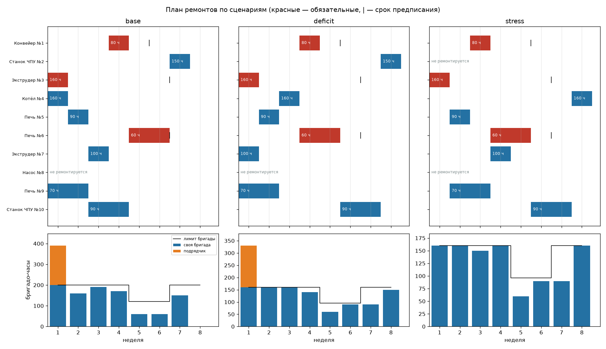
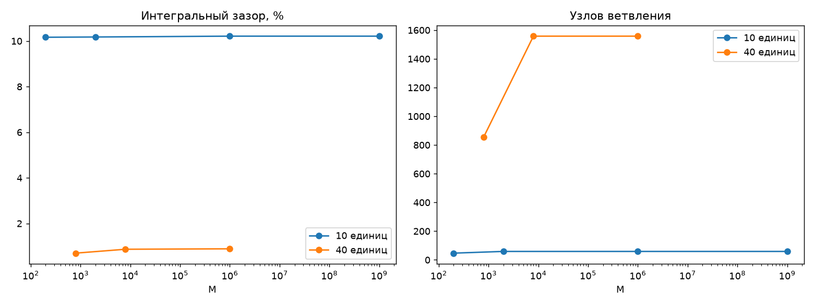
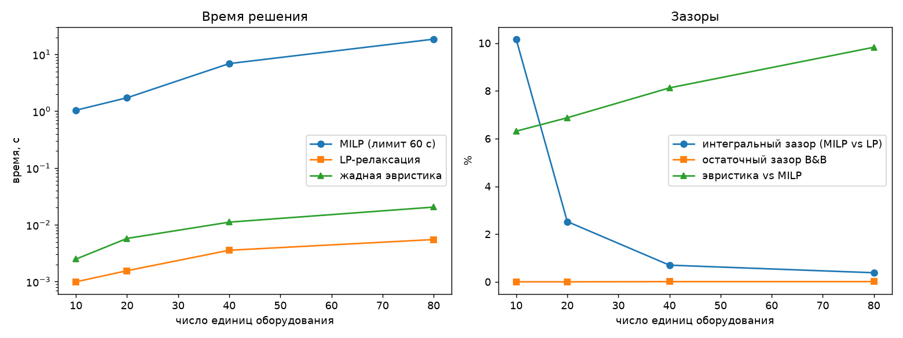

# Отчёт по лабораторной работе №3 «MILP-модель дискретного выбора»

**Вариант 16.** План ремонтов оборудования по неделям с бюджетом бригад: 10 единиц, 8 недель.
Группа 527 (Q = 2), N = 15, Y = 26 → V = 1 + (295 mod 20) = **16**, seed = **10215**.
Солвер: HiGHS 1.15.1 (`highspy`, ветвей и границ), Python 3.14.7. Запуск: `python run.py`.

## 1. Постановка задачи

В цехе 10 единиц оборудования (экструдеры, печи, котёл, станки ЧПУ и др.). Без ремонта каждая изнашивается:
вероятность отказа растёт каждую неделю, а отказ стоит 1–5 млн ₽. Ремонт длится 1–2 недели, требует часов
ремонтной бригады и останавливает единицу (потери выпуска). Нужно решить, **какие** единицы ремонтировать в
ближайшие 8 недель и **когда**, при условиях:

- собственная бригада — 200 бригадо-часов в неделю (на неделях 5–6 отпуска, 120 ч);
- сверх неё можно вызвать подрядчика: до 200 ч в неделю по 2500 ₽/ч плюс **фиксированные 150 000 ₽ за выход** на неделю;
- три единицы (Конвейер №1, Экструдер №3, Печь №6) по предписанию надзора обязаны пройти ремонт до срока (недели 5, 6, 6);
- одновременно в ремонте не более K = 3 единиц, иначе цех не выполнит план;
- пары единиц на одной технологической линии (Котёл №4 + Печь №6, Экструдер №3 + Станок ЧПУ №10) нельзя останавливать одновременно.

**Цель** — минимум суммы затрат на ремонт, потерь от простоя, ожидаемых потерь от отказов и оплаты подрядчика.

## 2. Данные (`data/`, seed 10215)

| Единица | Нед ремонта | Бригадо-ч/нед | Ремонт, тыс. ₽ | Простой, тыс. ₽/нед | Риск нед 1, тыс. ₽ | Рост риска | Обязательная (срок) |
|---|---|---|---|---|---|---|---|
| Конвейер №1 | 1 | 80 | 107 | 75 | 13,5 | ×1,164 | да (нед 5) |
| Станок ЧПУ №2 | 1 | 150 | 158 | 45 | 9,4 | ×1,215 | — |
| Экструдер №3 | 1 | 160 | 177 | 80 | 133,5 | ×1,093 | да (нед 6) |
| Котёл №4 | 1 | 160 | 208 | 124 | 49,2 | ×1,117 | — |
| Печь №5 | 1 | 90 | 82 | 196 | 62,4 | ×1,151 | — |
| Печь №6 | 2 | 60 | 83 | 82 | 25,3 | ×1,063 | да (нед 6) |
| Экструдер №7 | 1 | 100 | 231 | 64 | 37,5 | ×1,234 | — |
| Насос №8 | 2 | 130 | 129 | 135 | 24,2 | ×1,097 | — |
| Печь №9 | 2 | 70 | 130 | 153 | 59,3 | ×1,135 | — |
| Станок ЧПУ №10 | 2 | 90 | 109 | 42 | 52,3 | ×1,119 | — |

Риск недели t = цена отказа · P(отказ в неделю 1) · рост^(t−1) — это ожидаемые потери, если единица работает эту неделю без ремонта. Если ремонт не сделан в горизонте, к цели добавляется риск следующих 4 недель (до следующего планового окна).

Генерация (`maint/data_gen.py`): параметры единиц — равномерные распределения в правдоподобных диапазонах. `generate_frames(n)` строит экземпляр любого размера (бригада, лимиты и число конфликтов масштабируются).

## 3. Формальная MILP-модель

**Множества:** I — единицы, T = {1..8} — недели, S_i = {τ : τ + p_i − 1 ≤ min(8, срок_i)} — допустимые недели начала,
C — пары конфликтующих единиц.

**Параметры:** p_i — длительность ремонта, нед; h_i — бригадо-часов в неделю ремонта; c_i — стоимость ремонта, ₽;
v_i — потери от простоя, ₽/нед; ρ_it — риск недели, ₽; Π_i — риск после горизонта, ₽; B_t — часы своей бригады;
C_max = 200 ч, κ = 2500 ₽/ч, F = 150 000 ₽; K = 3; m_i ∈ {0,1} — обязательность.

**Переменные:**

| Переменная | Тип | Смысл | Число |
|---|---|---|---|
| z_iτ | **бинарная** | ремонт единицы i начинается в неделю τ | 76 |
| w_t | **бинарная** | подрядчик вызван на неделю t | 8 |
| o_t | непрерывная ≥ 0 | часы подрядчика в неделю t | 8 |

Вспомогательные линейные выражения: «в ремонте» down_it = Σ_{τ ∈ S_i, τ ≤ t ≤ τ+p_i−1} z_iτ;
«работает без ремонта» u_it = 1 − Σ_{τ ≤ t} z_iτ.

**Цель:**

min Σ_i Σ_τ (c_i + v_i p_i) z_iτ + Σ_i Σ_t ρ_it u_it + Σ_i Π_i (1 − Σ_τ z_iτ) + Σ_t (F w_t + κ o_t), ₽.

**Ограничения:**

1. Не более одного ремонта: Σ_τ z_iτ ≤ 1. Для обязательных — ровно один: Σ_τ z_iτ = 1, а срок задаётся множеством S_i.
2. Часы бригад: Σ_i h_i down_it ≤ B_t + o_t.
3. **Связка big-M:** o_t ≤ M_t · w_t — подрядчик работает, только если вызван (и оплачен выход F).
4. Не более K единиц в ремонте: Σ_i down_it ≤ K.
5. Конфликты линий: down_at + down_bt ≤ 1 для (a, b) ∈ C.

Размер: 92 переменные (84 бинарные, 8 непрерывных), 50 ограничений, 352 ненулевых коэффициента.

**Что нельзя выразить чистой ЛП:**

- **Неделимость ремонта.** Ремонт либо начинается в неделю τ целиком, либо нет. В ЛП можно было бы «отремонтировать на 44% в неделю 3 и на 56% в неделю 4».
- **Фиксированная плата за выход подрядчика.** Стоимость подрядчика F · [o_t > 0] + κ · o_t разрывна в нуле — это не выпуклая функция, и линейным неравенствам с непрерывными переменными она недоступна. Бинарная w_t и связка big-M делают её линейной.
- **Выбор подмножества** ремонтируемых единиц — тоже дискретное решение «да/нет».

### Выбор константы big-M

M_t должно быть не меньше любого допустимого o_t, иначе отсекаются законные планы. При этом оно должно быть как можно меньше, иначе ослабляется LP-релаксация. Обоснованное значение (`tight_M` в `model.py`):

M_t = min(C_max, max(0, Σ_{K крупнейших h_i} − B_t)) = min(200, 160 + 160 + 150 − B_t) = min(200, 270…350) = **200**.

Логика: подрядчик больше 200 ч не даст по договору, а нагрузки, превышающей сумму трёх самых трудоёмких одновременных ремонтов минус свою бригаду, не бывает. Здесь связывает договорной лимит, поэтому M = C_max и связка заодно задаёт лимит подрядчика.

## 4. Решение базового сценария

**Статус `Optimal`, зазор ветвления 0%.** HiGHS нашёл решение и доказал оптимальность: нижняя граница (dual bound) 4 068 743 ₽ совпадает с найденным значением. 47 узлов дерева ветвлений, ≈ 1,1 с.

**Минимальные затраты — 4 068 743 ₽:** ремонты 1 285 000, простои 1 138 000, остаточный риск отказов 1 020 743, подрядчик 625 000 (выход 150 000 + 190 ч × 2500).

| Единица | Неделя ремонта | Комментарий |
|---|---|---|
| Экструдер №3 (обяз.) | 1 | самый большой риск (133 тыс. ₽/нед) — сразу |
| Котёл №4 | 1 | вместе с Экструдером №3 это 320 ч > 200 → **вызывается подрядчик на 190 ч** |
| Печь №9 | 1–2 | |
| Печь №5 | 2 | |
| Экструдер №7, Станок ЧПУ №10 | 3; 3–4 | |
| Конвейер №1 (обяз.) | 4 | срок — неделя 5 |
| Печь №6 (обяз.) | 5–6 | ровно к сроку; лёгкий ремонт (60 ч) на неделях отпусков |
| Станок ЧПУ №2 | 7 | самый низкий риск, когда бригада свободна |
| Насос №8 | **не ремонтируется** | см. ниже |

**Почему Насос №8 не ремонтируется.** Ремонт при начале на неделе 1 сэкономил бы всего ≈ 109 тыс. ₽: риск невелик, а ремонт длится 2 недели и даёт 270 тыс. ₽ простоя. Каждая неделя задержки съедает эту выгоду, и с недели 5 ремонт уже убыточен. При этом первые недели заняты единицами, ремонт которых экономит 0,8–2,5 млн ₽. Вытеснять их ради насоса или платить 150 тыс. ₽ за подрядчика невыгодно.

**Независимая проверка** (`maint/verify.py`) получает только CSV исходных данных и таблицу «единица → неделя начала» с вызовами подрядчика. По ним она восстанавливает простои и нагрузку и проверяет 102 условия:
- целочисленность и сроки предписаний;
- часы бригад;
- двоичность вызова;
- связку big-M — проверяются и формальное o ≤ M · w, и **физический смысл** «часы подрядчика > 0 ⇒ подрядчик вызван»;
- лимит K и конфликты линий;
- пересчёт цели «с нуля» (риск по неделям до начала ремонта).

Все условия выполнены, максимальное нарушение 4,7·10⁻⁹. Пересчитанная цель совпала с солвером.

## 5. LP-релаксация и интегральный зазор

Без требования целочисленности (`results/highs_base_relaxation.log`) оптимум — **3 655 124 ₽**.
**Интегральный зазор** (MILP − LP) / MILP = **10,17%**.

| | LP-релаксация | MILP |
|---|---|---|
| Ремонт | 1 285 000 | 1 285 000 |
| Простой | 1 138 000 | 1 138 000 |
| Риск отказов | 1 232 124 | 1 020 743 |
| Подрядчик | **0** | **625 000** |
| Итого | 3 655 124 | 4 068 743 |

**Где ломается непрерывное решение** (`results/relaxation_fractional.csv`, 12 дробных переменных):

- **Ремонты «размазываются» по соседним неделям:** Котёл №4 — 0,44 в неделю 3 и 0,56 в неделю 4; Печь №5 — 0,44 / 0,56 в недели 1 / 2; Станок ЧПУ №10 — 0,44 / 0,56 в недели 3 / 5. Нагрузка на бригаду выравнивается «дробными ремонтами», и **подрядчик в ЛП не нужен вовсе**.
- **В MILP так нельзя:** Котёл приходится либо ставить целиком на занятую неделю 1 (и платить 150 тыс. ₽ за выход подрядчика плюс 190 ч), либо откладывать с ростом риска. Оптимум выбирает первое: подрядчик окупается снижением риска (1,02 млн против 1,23 млн ₽ в ЛП).
- **Подрядчик в ЛП был бы дробным:** если бы ЛП его использовала, то с w_t = o_t / M платила бы за выход лишь долю F. Поэтому значение M прямо влияет на силу релаксации (раздел 8).

Набор ремонтируемых единиц совпадает (затраты на ремонт равны), то есть релаксация верно угадывает **что** делать, но не **когда**. Отсюда и зазор.

## 6. Сценарный анализ

| Сценарий | Статус | Затраты, ₽ | Δ к базе | LP-зазор | Узлов | Не ремонтируются | Подрядчик |
|---|---|---|---|---|---|---|---|
| Базовый | Optimal | 4 068 743 | — | 10,17% | 47 | Насос №8 | нед 1: 190 ч |
| Дефицит: бригада −20% | Optimal | 4 259 668 | +190 925 (+4,7%) | 4,58% | 3 | Насос №8 | нед 1: 170 ч |
| Стресс: бригада −20% и подрядчик недоступен на неделях 1–3 | Optimal | 4 333 005 | +264 261 (+6,5%) | 5,87% | 1 | **Насос №8, Станок ЧПУ №2** | не вызывается |
| Стресс-2: бригада −40%, подрядчика нет | **Infeasible** | — | — | — | — | — | — |

Как меняется **набор и порядок** (а не только цель):

- **Дефицит.** Подрядчик по-прежнему вызывается на неделю 1, но вместо Котла №4 туда ставится Экструдер №7 (растущий риск ×1,234). Котёл сдвигается на неделю 3, Станок ЧПУ №10 — на 6–7, Станок ЧПУ №2 — на 8. Набор тот же, порядок другой.
- **Стресс.** Без подрядчика в начале горизонта и с урезанной бригадой (160 ч) Котёл №4 (160 ч) не помещается рядом с Экструдером №3 и уходит на неделю 8. **Станок ЧПУ №2 выпадает из плана** — на него не остаётся часов. Подрядчик на неделях 4–8 доступен, но не вызывается: выход за 150 тыс. ₽ на этих неделях не окупается.
- **Стресс-2 — статус `Infeasible`.** HiGHS доказал, что допустимого плана нет. Чтобы найти причину, обязательные ремонты переведены в «желательные» со штрафом 10⁹ ₽ за невыполнение (`diagnose_infeasible`). Невыполнимым оказался ремонт **Экструдера №3**: ему нужно 160 бригадо-часов в неделю, а бригада при −40% даёт не больше 120 ч, подрядчика нет. Остальные предписания выполнимы. Выход для руководства: обеспечить подрядчика хотя бы на одну неделю до 6-й или перенести срок предписания.

## 7. Сравнение с жадной эвристикой

Эвристика (`maint/heuristic.py`) ставит единицы по очереди: сначала обязательные по сроку, затем по убыванию риска. Каждой выбирается неделя с минимальным приростом затрат с учётом лимитов и оплаты подрядчика. Необязательная единица пропускается, если ремонт невыгоден.

| Сценарий | MILP, ₽ | Эвристика, ₽ | Зазор | Время MILP | Время эвристики |
|---|---|---|---|---|---|
| Базовый | 4 068 743 | 4 325 535 | +6,3% | 1,1 с | 3 мс |
| Дефицит | 4 259 668 | 4 512 894 | +5,9% | 0,34 с | 3 мс |
| Стресс | 4 333 005 | 4 949 368 | +14,2% | 0,30 с | 2 мс |

Эвристика всегда даёт допустимый план (проверен тем же `verify.py`), но фиксирует решение для единицы раз и навсегда. Экструдер №3, поставленный первым, занимает неделю 1, и рисковые единицы уходят дальше: эвристика «не знает», что выгоднее было бы вызвать подрядчика. В стрессе, где ресурсов мало и порядок важнее, зазор растёт до 14%.

## 8. Выбор big-M и что происходит при неоправданно большом M

`results/bigM_experiment.csv`, presolve включён:

| Единиц | M | LP-релаксация, ₽ | Интегральный зазор | Узлов | Время, с |
|---|---|---|---|---|---|
| 10 | 200 (обоснованное) | 3 655 124 | 10,17% | 47 | 1,08 |
| 10 | 2 000 | 3 654 676 | 10,18% | 59 | 1,18 |
| 10 | 10⁶ | 3 653 179 | 10,21% | 59 | 1,17 |
| 10 | 10⁹ | 3 653 176 | 10,21% | 59 | 1,20 |
| 40 | 800 (обоснованное) | 16 214 582 | 0,70% | 855 | 7,3 |
| 40 | 8 000 | 16 186 736 | 0,87% | 1558 | 8,4 |
| 40 | 10⁶ | 16 183 574 | 0,89% | 1558 | 8,8 |

1. **Слабее LP-релаксация.** В релаксации w_t = o_t / M, а за выход платится F · o_t / M. При M = 10⁶ это 0,15 ₽ за час вместо 750 ₽ за час при M = 200: фиксированная стоимость практически исчезает из нижней границы. Максимальное дробное w в релаксации для 40 единиц падает с 0,14 до 0,00017.
2. **Больше ветвления.** На 40 единицах число узлов растёт на 82% (855 → 1558), время — на 14–20%. Абсолютное время между запусками колеблется в разы (зависит от загрузки машины), поэтому надёжнее сравнивать число узлов — оно детерминировано. На 10 единицах эффект слабее, потому что зазор определяется в основном неделимостью ремонтов, а не подрядчиком.
3. **Численная ловушка — неверный ответ.** При M = 10⁹ значение w = 10⁻⁷ допускает o = 100 ч, а 10⁻⁷ меньше допуска целочисленности HiGHS (10⁻⁶), то есть формально считается нулём. С включённым presolve HiGHS сам ужесточает коэффициент, и ловушка не срабатывает. **Без presolve** (`results/highs_bigM_presolve_off_1e9.log`) HiGHS сообщил **`Optimal` со значением 3 937 714 ₽ — на 131 тыс. ₽ ниже настоящего оптимума.** В его плане подрядчик работает 30, 40 и 50 ч на неделях 2–4, а w ≈ 0: выход не оплачен. Независимая проверка ловит это нарушением «часы подрядчика ≤ C_max · вызов» (`results/contractor_presolve_off_1e9.csv`). С обоснованным M = 200 тот же запуск без presolve даёт верный оптимум 4 068 743 ₽.

Вывод: M выбирают из предметных границ (договорной лимит, максимальная одновременная нагрузка), а не «с запасом». Большое M одновременно ослабляет релаксацию и рискует дать формально оптимальный, а фактически недопустимый план.

## 9. Масштабирование: время и зазор

Экземпляры из того же генератора: 10, 20, 40, 80 единиц (бригада, K, лимит подрядчика и конфликты растут пропорционально), лимит времени 60 с (`results/scaling.csv`).

| Единиц | Бинарных | Ограничений | LP, мс | MILP, с | Узлов | Статус | Интегральный зазор | Эвристика vs MILP |
|---|---|---|---|---|---|---|---|---|
| 10 | 84 | 50 | 1 | 1,05 | 47 | Optimal | 10,17% | +6,3% |
| 20 | 158 | 76 | 2 | 1,9 | 157 | Optimal | 2,52% | +6,9% |
| 40 | 316 | 128 | 3 | 7,1 | 855 | Optimal* | 0,70% | +8,1% |
| 80 | 620 | 232 | 7 | 18,3 | 1906 | Optimal* | 0,38% | +9,8% |

\* для 40 и 80 единиц ветвление остановлено по допуску HiGHS mip_rel_gap = 10⁻⁴ (остаточный зазор 0,01%).

Время MILP зависит от загрузки машины: в контрольном прогоне на занятой машине вышло 3,2 / 6,9 / 18,1 / 37,7 с. Число узлов, зазоры и значения целей при этом совпали до последнего знака, а характер роста сохраняется: время MILP увеличивается в 12–17 раз при росте задачи в 8 раз.

- **Время MILP растёт сверхлинейно** (1,05 → 18,3 с при росте размера в 8 раз), а LP и эвристика — линейно, в миллисекундах. Число узлов ветвления растёт в 40 раз: каждая новая бинарная переменная потенциально удваивает дерево, хотя отсечения и presolve сильно сокращают перебор.
- **Относительный интегральный зазор падает с ростом задачи:** в большом цехе «дробные» эффекты нескольких единиц малы на фоне общей суммы, а оплата подрядчика — малая доля затрат.
- **Зазор эвристики, наоборот, растёт:** чем больше единиц конкурирует за бригаду, тем дороже близорукий порядок вставки.

## 10. Выводы

Сравнение двух эквивалентных MILP-формулировок вынесено в [отдельный отчёт по заданию со звёздочкой](formulation_star/REPORT.md).

1. Оптимальный план на 8 недель стоит **4,07 млн ₽**. Ремонтируются 9 из 10 единиц, все предписания выполняются, подрядчик вызывается один раз — на неделю 1, чтобы одновременно убрать два самых больших риска (Экструдер №3 и Котёл №4). Насос №8 разумно отложить до следующего окна.
2. LP-релаксация занижает затраты на 10%: она дробит ремонты по неделям и обходится без подрядчика. Именно неделимость ремонта и фиксированная плата за выход подрядчика делают задачу MILP.
3. Дефицит бригады −20% стоит +4,7%, а потеря подрядчика в первые недели вдобавок вычёркивает из плана Станок ЧПУ №2. При −40% и без подрядчика предписание по Экструдеру №3 выполнить нельзя.
4. Обоснованное M = 200 (договорной лимит подрядчика) даёт самую сильную релаксацию. Огромное M увеличивает дерево ветвлений на 82% (40 единиц), а без presolve приводит к ложному «оптимуму» с неоплаченным подрядчиком.
5. Жадная эвристика в сотни раз быстрее, но дороже на 6–14%, причём отставание растёт с размером и дефицитом ресурсов.
### Можно ли реализовать решение на практике?

Да, как план ремонтного окна на 2 месяца — с оговорками:

- **риск отказа — ожидаемое значение:** реальный отказ случаен, план нужно пересчитывать при каждом отказе или новой диагностике (скользящий горизонт);
- **бригадо-часы взаимозаменяемы:** в жизни нужны конкретные специальности (электрик, сварщик), то есть часы по квалификациям;
- **длительность ремонта фиксирована:** при задержке поставки запчастей ремонт может затянуться и сорвать сроки предписаний;
- **граница горизонта:** перенос Насоса №8 «за горизонт» учтён лишь грубо — как 4 недели риска.

Для практики модель стоит дополнить специальностями бригад, сценариями длительности ремонта и ежемесячным пересчётом плана.
